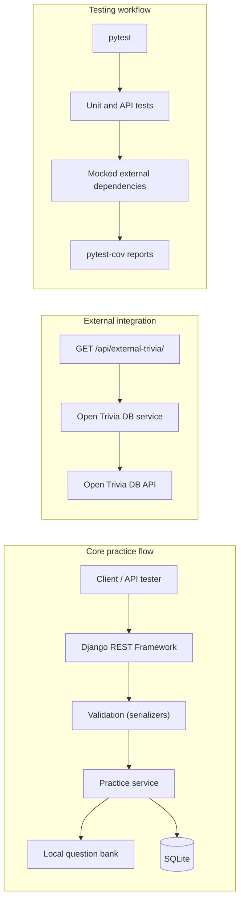

# SmartPrep — IMAP Exam Practice API

## 1. Overview and problem statement
Students preparing for the **IMAP** module (an academic subject — *not* the e-mail protocol) need quick topic-wise practice. SmartPrep is a small Django REST Framework API that generates practice sets, scores answers on the server, and stores results. The real focus of this group assignment (**Topic 3: Automated Testing with pytest**) is the test suite: unit tests, API tests, mocked external HTTP calls and coverage reports.

## 2. Objectives and features
- Choose topic + difficulty (easy/medium/hard) + number of questions; get a practice set.
- Submit answers; get score, correct/incorrect counts, percentage and explanations.
- Correct answers stay server-side until submission.
- Clear JSON validation errors; safe handling of external API failures and timeouts.
- Optional general-knowledge endpoint backed by Open Trivia DB (the required external API).

## 3. Topics (exactly seven)
HTML, CSS, JavaScript, MongoDB, NoSQL, Django, Docker. (56 original questions: 8 per topic.)

## 4. Technology stack
Python 3.11+, Django, Django REST Framework, SQLite, requests, pytest, pytest-django, pytest-cov. No Node.js, Docker, MongoDB server, API keys or paid services are needed.

## 5. Architecture diagram


## 6. Directory structure
```
smartprep/
├── manage.py  requirements.txt  pytest.ini  .coveragerc  .gitignore  README.md
├── config/      settings.py urls.py wsgi.py asgi.py
├── practice/    models.py serializers.py views.py urls.py services.py
│                question_bank.py exceptions.py migrations/0001_initial.py
└── tests/       conftest.py test_question_bank.py test_services.py
                 test_api.py test_results.py
```

## 7. Prerequisites
Windows 10/11, Python 3.11+ (from python.org, "Add to PATH" ticked), Git, PowerShell, optionally an API client (Postman, Thunder Client) or PowerShell's `Invoke-RestMethod`.

## 8–10. Setup (Windows PowerShell)
```powershell
cd path\to\smartprep
py --version
py -m venv .venv
.\.venv\Scripts\Activate.ps1          # if blocked: Set-ExecutionPolicy -Scope CurrentUser RemoteSigned
python -m pip install -r requirements.txt
python manage.py migrate
python manage.py check
python manage.py runserver
```
Open `http://127.0.0.1:8000/api/topics/`. Dependency versions use compatible-release pins (`~=`) so pip picks the newest compatible patch. If `python manage.py makemigrations --check` ever reports changes, run `python manage.py makemigrations practice`.

## 11. API reference
| Method | URL | Purpose |
|---|---|---|
| GET | `/api/health/` | Status (no external calls) |
| GET | `/api/topics/` | The seven topics |
| POST | `/api/practice-sets/` | Create a set (201) |
| GET | `/api/practice-sets/<attempt_id>/` | Questions + options (no answers) |
| POST | `/api/practice-sets/<attempt_id>/submit/` | Submit answers, get score |
| GET | `/api/results/<attempt_id>/` | Saved result (completed attempts only) |
| GET | `/api/external-trivia/?amount=5` | General-knowledge questions (1–20) from Open Trivia DB |

**Answer format (used everywhere):** options are keyed `"A"`–`"D"`; submissions use `{"question_id": <int>, "selected_answer": "<A-D, uppercase>"}`. Amount per set: 1–10. Attempt IDs are UUIDs and are identifiers, **not** an access-control mechanism (no authentication by design).

## 12. Example requests and responses
```powershell
$set = Invoke-RestMethod -Method Post -Uri http://127.0.0.1:8000/api/practice-sets/ `
  -ContentType "application/json" -Body '{"topic":"Django","difficulty":"easy","amount":3}'
$set | ConvertTo-Json -Depth 5

$body = @{ answers = @(
  @{ question_id = $set.question_ids[0]; selected_answer = "A" },
  @{ question_id = $set.question_ids[1]; selected_answer = "B" } ) } | ConvertTo-Json -Depth 5
Invoke-RestMethod -Method Post -Uri "http://127.0.0.1:8000/api/practice-sets/$($set.attempt_id)/submit/" `
  -ContentType "application/json" -Body $body
Invoke-RestMethod "http://127.0.0.1:8000/api/results/$($set.attempt_id)/"
```
Create response (shape; IDs and wording vary):
```json
{"attempt_id": "<uuid>", "topic": "Django", "difficulty": "easy", "status": "in_progress",
 "total_questions": 3, "question_ids": [41, 42, 43],
 "questions": [{"id": 41, "topic": "Django", "difficulty": "easy", "question": "...",
                "options": {"A": "...", "B": "...", "C": "...", "D": "..."}}]}
```
Submit response (shape): `total_questions, answered_questions, correct_answers, incorrect_answers, percentage, completed_at, details[]` where each detail has `question_id, selected_answer, correct_answer, is_correct, explanation`.

## 13. Validation and error examples
All errors look like `{"error": {"code": "...", "message": "...", "details": {...}}}`.
| Situation | Status | code |
|---|---|---|
| Bad topic/difficulty/amount, malformed answers | 400 | `validation_error` |
| Malformed JSON body | 400 | `parse_error` |
| Question ID not in this attempt / duplicated | 400 | `invalid_submission` |
| Unknown attempt (or non-UUID id) | 404 | `attempt_not_found` |
| Wrong HTTP method | 405 | `method_not_allowed` |
| Second submission | 409 | `already_submitted` |
| Result requested before submission | 409 | `attempt_not_completed` |
| Not enough questions (e.g. 10 easy Django) | 422 | `insufficient_questions` |
| Open Trivia DB timeout | 504 | `external_timeout` |
| Open Trivia DB down / bad HTTP / bad data | 502 | `external_unavailable`, `external_http_error`, `external_invalid_response`, `external_no_results` |
| Open Trivia DB rate limit | 429 | `external_rate_limited` |

## 14. Example score calculation
3 questions, 1 correct, 1 wrong, 1 unanswered → correct = 1, incorrect = 3 − 1 = 2 (**unanswered counts as incorrect**), answered = 2, percentage = 1/3 × 100 = **33.33**. Repeated submissions are **rejected** (409); the first saved result is kept.

## 15. Local question bank design
`practice/question_bank.py` holds 56 original questions as plain Python data (works offline). Each has id, topic, difficulty, question, four options (A–D), correct letter and explanation. When a set is created, the selected questions are stored as a **JSON snapshot** in SQLite, so later edits to the bank never change an existing attempt.

## 16. Open Trivia DB integration
`practice/services.py::fetch_trivia_questions` calls `https://opentdb.com/api.php` with `requests` (8 s timeout), checks status codes, handles timeouts/connection errors/bad JSON/response codes/unexpected payloads, decodes HTML entities, normalizes output and raises `ExternalAPIError` with a safe message (no internal exception text). Open Trivia DB supplies **general knowledge only**; it does not supply the seven syllabus topics.

## 17. Testing strategy
- **Unit tests** (`-m unit`: `test_question_bank.py`, `test_services.py`): question data, selection, formatting, grading, percentages, and the Open Trivia service with `requests.get` mocked.
- **API tests** (`-m api`: `test_api.py`, `test_results.py`): real routes, serializers, views and SQLite through DRF's `APIClient`.
- **Where to mock:** service tests mock the lowest layer (`practice.services.requests.get`) so the real service code runs. API tests may mock the service function where the view looks it up (`practice.views.fetch_trivia_questions`) to isolate view behaviour; one API test mocks only `requests.get` to run view + service together.
- An autouse fixture blocks all live HTTP, so no test can reach Open Trivia DB.

## 18. Fixtures and mocks
- **Fixture:** reusable setup/teardown code declared with `@pytest.fixture` (see `tests/conftest.py`).
- **Injection:** put the fixture's name as a test-function parameter and pytest passes in its value.
- **Mock:** a stand-in object/function that replaces a real dependency (here, the HTTP call) with controlled behaviour.
- **monkeypatch:** a built-in fixture (`monkeypatch.setattr(target, name, replacement)`) that swaps something for one test and automatically restores it afterwards.
- **Why mock external APIs:** tests stay fast, deterministic, offline, free of rate limits, and can simulate timeouts/errors that are hard to trigger for real.
- **Isolation:** pytest-django wraps each DB test in a rolled-back transaction; monkeypatching is undone after each test; no test depends on another.

## 19. Testing pyramid
Many small, fast **unit tests** at the base; fewer **integration tests** (components working together) in the middle; very few slow **end-to-end tests** (full workflow through a real system, e.g. a browser) at the top. Lower tests are cheap and pinpoint failures; higher tests are realistic but slow and brittle.
In SmartPrep: unit = `test_question_bank.py`, `test_services.py`; integration = `test_api.py`, `test_results.py` (route → serializer → view → service → database). **No browser-based end-to-end tests exist.** An API test with a mocked external service does *not* prove the real Open Trivia DB works — that needs a manual check of `/api/external-trivia/` while online.

## 20. Answers to the three research questions
1. **What is the testing pyramid?** A model recommending many unit tests, fewer integration tests and fewest end-to-end tests, for speed, cost and reliable diagnosis (see §19).
2. **Unit vs integration tests?** A unit test checks one small piece in isolation (e.g. `calculate_percentage`). An integration test checks that several pieces work together (e.g. POST → serializer → view → service → SQLite).
3. **Fixtures, mocks, and what coverage doesn't tell you?** Fixtures provide reusable test setup; mocks replace dependencies with controlled fakes (§18). Coverage shows which lines/branches ran, **not** whether assertions are meaningful, whether inputs/edge cases were covered, or whether the real external service works (§22).

## 21. pytest and coverage commands
```powershell
pytest                                            # all tests
pytest -m unit                                    # unit tests only
pytest -m api                                     # API tests only
pytest --cov=practice --cov-report=term-missing   # terminal coverage + missing lines
pytest --cov=practice --cov-report=html           # writes htmlcov\
start htmlcov\index.html                          # open the report in the default browser
```
Settings live in `pytest.ini` (Django settings module, markers) and `.coveragerc` (branch coverage on, migrations omitted).

## 22. Coverage limitations
Statement coverage reports which lines ran; `term-missing` lists the lines that never ran. 100% coverage does not mean bug-free: a line can run without being asserted, many input values and branch combinations go untested, mocks can hide real-world behaviour, and missing requirements are invisible to coverage. Meaningful assertions and edge-case tests matter more than the percentage. Report only the numbers you actually see when you run it.

## 23. Limitations and future improvements
No authentication (attempt IDs are identifiers only); one fixed local bank of 56 questions; SQLite only; no live-API contract test; no browser end-to-end tests. Ideas: user accounts, more questions, a CI workflow running pytest, a scheduled live smoke test of Open Trivia DB.

## 24. Group members and roles
| Member | Role |
|---|---|
| _Name 1_ | API/views and serializers |
| _Name 2_ | Question bank and services |
| _Name 3_ | Unit tests, fixtures, mocks |
| _Name 4_ | API tests, coverage |
| _Name 5_ | README, demo, GitHub |

## 25. Suggested Git commits
1. `chore: scaffold Django project and settings`
2. `feat: add local IMAP question bank`
3. `feat: add PracticeAttempt model and migration`
4. `feat: add practice-set and submit endpoints`
5. `feat: add Open Trivia DB service and endpoint`
6. `test: add unit tests for bank and services`
7. `test: add API and results tests`
8. `chore: configure pytest-cov`
9. `docs: add README, diagram and viva notes`

## 26. Ten-minute presentation plan
- **Min 1:** introduce SmartPrep and Topic 3.
- **Min 2–3:** architecture diagram and seven topics.
- **Min 4–5:** live demo — create set, submit answers, show result.
- **Min 6–7:** show unit tests, API tests, `conftest.py` fixtures, `monkeypatch` mocks.
- **Min 8–9:** run `pytest` and open the real coverage report.
- **Min 10:** findings (what coverage does and doesn't prove) and limitations.

## 27. Viva questions
1. **What is pytest?** A Python testing framework with plain `assert`s, fixtures and plugins.
2. **Testing pyramid?** Many unit, fewer integration, fewest end-to-end tests.
3. **Unit test?** Tests one small piece in isolation.
4. **Integration test?** Tests several components working together.
5. **API test?** Sends requests to the API routes and checks status codes, JSON and database effects (`APIClient`).
6. **Fixture?** Reusable test setup injected by parameter name.
7. **Mock?** A controlled replacement for a real dependency.
8. **monkeypatch?** pytest fixture that temporarily replaces attributes and restores them afterwards.
9. **Code coverage?** The share of code executed by tests.
10. **Why doesn't high coverage guarantee quality?** Lines can run without checks; edge cases and requirements may be untested.
11. **Why mock external APIs?** Speed, determinism, no rate limits/internet needs, and simulating failures.
12. **How are timeouts handled?** `requests.get(..., timeout=8)`; `requests.Timeout` becomes `ExternalAPIError("external_timeout")` → HTTP 504 with a safe message.
13. **How is the score calculated?** Server-side comparison with the stored snapshot; unanswered = incorrect; percentage = correct ÷ total × 100, rounded to 2 decimals.
14. **How are correct answers protected?** Create/retrieve responses use `public_question`, which omits answer and explanation; they appear only after submission.
15. **Local bank vs Open Trivia DB?** Local = the seven syllabus topics, offline, used for practice sets; Open Trivia DB = separate general-knowledge feed on its own endpoint.
16. **Why DRF?** Serializers for validation, parsing/rendering JSON, `APIView`, consistent error handling and `APIClient` for tests.

## 28. Troubleshooting
- *Activate.ps1 blocked:* `Set-ExecutionPolicy -Scope CurrentUser RemoteSigned`.
- *`py` not found:* reinstall Python with "Add to PATH" or use `python`.
- *`ModuleNotFoundError`:* activate the venv and re-run `pip install -r requirements.txt`.
- *`no such table`:* run `python manage.py migrate`.
- *Port in use:* `python manage.py runserver 8001`.
- *No coverage output:* run from the project root with the venv active.

## 29. Screenshot checklist (capture your own, from real runs)
Topic list · practice-set response · submission and score · a validation error · the mocked timeout test (`pytest -k timeout -v`) · full `pytest` output · terminal coverage · HTML coverage report · project directory · GitHub repository (after publishing).

## 30. GitHub publication
Create an empty repository named `smartprep-imap-exam-practice-api` on GitHub (no README), with description: *Django REST Framework exam practice API for HTML, CSS, JavaScript, MongoDB, NoSQL, Django, and Docker, demonstrating pytest automation, mocked external API calls, and pytest-cov coverage.*
```powershell
git status
git init
git add .
git commit -m "Initial commit: SmartPrep exam practice API"
git branch -M main
git remote add origin https://github.com/YOUR_USERNAME/smartprep-imap-exam-practice-api.git
git push -u origin main
```

## 31. Final submission checklist
- [ ] `pytest` passes on your machine
- [ ] Coverage output and `htmlcov` screenshots captured from your run
- [ ] Group names/roles filled in (§24)
- [ ] Open `/api/external-trivia/` once while online to confirm the live API works
- [ ] Screenshots taken (§29)
- [ ] Repository pushed; real URL added to your submission
